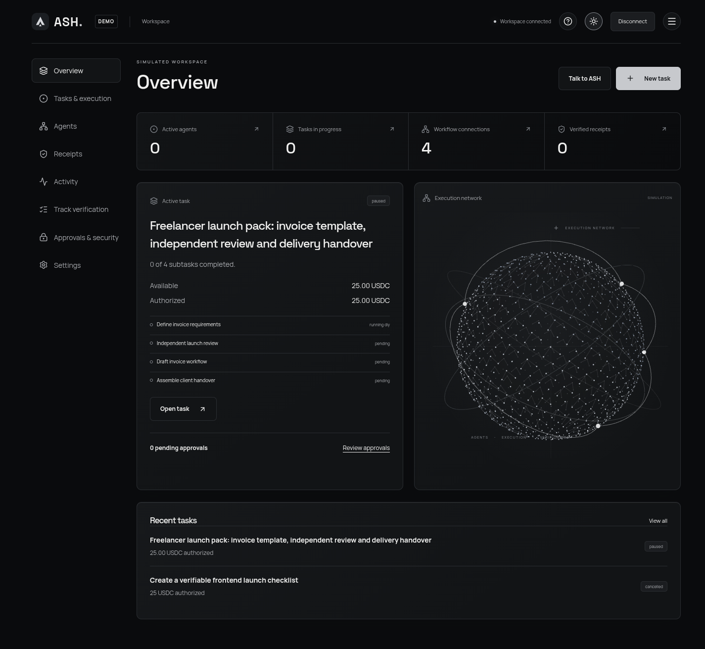

# Ash

**Plan tasks, review agent work, and track budgets in one workspace.**

Ash connects a model planner to the NEAR AI Agent Market. Create a task, review its
plan and spending limits, run local work or hire specialists, then review the
results and export task history and receipts. The terminal and browser share the
same backend and saved state.



## Try the demo

Requires Node.js 22.13+ and npm 10+. Go 1.25+ enables the full-screen terminal;
a command shell is available without Go.

```sh
git clone https://github.com/festac-dev/Ash.git
cd Ash
npm ci --ignore-scripts
npm run demo
```

The demo uses simulated model and marketplace providers in a fresh temporary data
directory. It walks through planning, approval, delivery review and receipt export,
then opens the terminal. It ignores existing credentials and task data.

To run the walkthrough without opening the terminal:

```sh
npm run demo -- --headless --json
```

The final JSON reports the task status, receipt count and integrity result. A
successful run has `"status": "completed"`, `"integrity": true` and `"simulated": true`.
Negative-budget and incorrect-approval checks are intentional rejected inputs.
The `data_dir` field identifies the generated task, deliverables and exports.

To check those receipts again, replace `/path/from/data_dir` with that field's value:

```sh
ASH_DEMO=1 ASH_DATA_DIR=/path/from/data_dir npm run verify -- --json
```

The result reports `"command": "verify"`, `"ok": true` and the receipt count.

[Watch the recorded simulation](https://x.com/i_am_festac/status/2118371914884211011).

## Open the browser workspace

Browser access starts off. While the terminal is running:

1. Press **B** to start the browser listener and display its URL.
2. Press **B** again to display a one-time access code.
3. Open the printed `/workspace` URL and enter that code.

Press **B** once more to close browser access. In the command shell, type `B` and
Enter; `npm run demo -- --shell` selects that shell explicitly. Codes expire after
five minutes by default and work once.

`/workspace/controls` contains planning, approvals, execution and settings. The
public landing page at `/` introduces Ash. [Browser guide](docs/FRONTEND.md).

## Use your own providers

Build Ash, then copy [.env.example](.env.example) to `.env` if you do not already
have a configuration file:

```sh
npm run build
```

Configure an OpenAI-compatible model endpoint or Ollama using
`ASH_MODEL_PROVIDER`, `ASH_MODEL_NAME` and `ASH_MODEL_BASE_URL`. Use
`ASH_MODEL_API_KEY` or `ASH_MODEL_API_KEY_FILE` when the provider requires a key.
[Configuration examples](docs/INSTALL.md#model-configuration).

Authorize marketplace buyer access:

```sh
npm start -- market login
npm start -- market auth-status --json
npm start
```

Open the official verification URL and enter the code shown in your terminal.
Ash stores and refreshes the buyer tokens locally. A manually supplied
`MARKET_API_TOKEN` or `MARKET_API_TOKEN_FILE` is also supported.

Create a task with **N**, set its maximum budget and review the generated plan.
With the plan-then-approve strategy, enter the exact approval phrase before
execution. External jobs use the marketplace; funding and final acceptance require
action on its human-facing pages. Review the deliverable, then inspect or export
its receipt from the terminal or browser. [Task commands](docs/COMMANDS.md).

The bundled walkthrough exercises this flow with simulated providers. A complete
live marketplace hire is not demonstrated by that walkthrough.

## Budgets, receipts and storage

Ash validates plan budgets and dependency order, tracks local reservations and
accounting, and gates operations with explicit approvals. Marketplace funding and
payment status are separate from local accounting.

Each finalized subtask can produce a SHA-256-linked JSON receipt. `verify` checks
receipt contents, ordering and the local chain head; `export` produces readable
and machine-readable task evidence:

```sh
npm start -- transactions --json
npm start -- verify --json
npm start -- export --json
```

The chain detects inconsistencies against its recorded head. It is a local integrity
check; replacing the entire chain and head can produce a consistent replacement.
Delivery review and provider payment records establish their own results.
[Receipt format and verification](docs/TRANSACTIONS.md).

State defaults to `.ash-data`. Keep credentials and this directory private.
Hosted model and marketplace operations send the information needed for their
requests. Ollama supports local inference. [Security and privacy](docs/SECURITY.md).

## NEAR payment workflows

The CLI and API include account inspection, dry swap quotes, invoice settlement,
revenue allocation, agent balances, pool payouts and Sputnik bounty settlement.
Use the [workflow reference](docs/TRACKS.md) for payloads and exact payment checks:

```sh
npm start -- mainnet check --json
npm start -- mainnet evidence --json
```

Mainnet inspection requires live mode. Signing is an optional operator CLI capability
and starts disabled. [Recorded native-transfer evidence](docs/evidence/native-transfer.json)
covers one approved self-transfer and reconciliation.

## Development and deployment

```sh
npm run typecheck
npm test
npm run test:tui
npm run build
```

[Development](docs/DEVELOPMENT.md) covers the remaining checks and prerequisites.
[Installation](docs/INSTALL.md), [API](docs/API.md) and
[architecture](docs/ARCHITECTURE.md) describe the supported interfaces.
[Deployment](docs/DEPLOYMENT.md) covers persistent storage, Docker, hosting and
reverse proxies; [remote access](docs/REMOTE.md) covers SSH tunnels and HTTPS.

Ash reuses the existing task-planning, marketplace, approval and receipt workspace.
The extension adds NEAR commerce workflows, constrained signing, artifact verification
and dependency handoffs. Dependencies are listed in [package.json](package.json)
and [tui/go.mod](tui/go.mod).

Licensed under [Apache-2.0](LICENSE).
