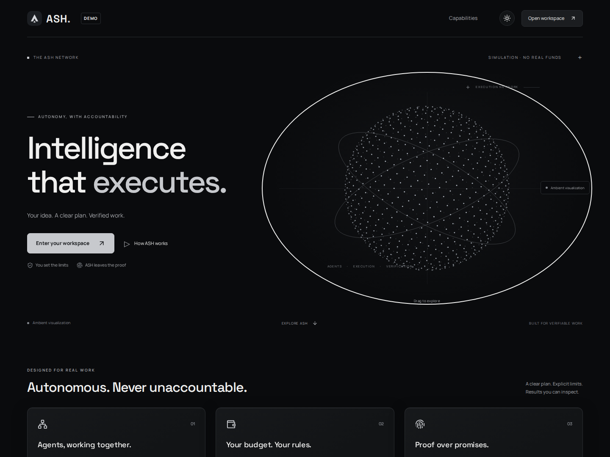
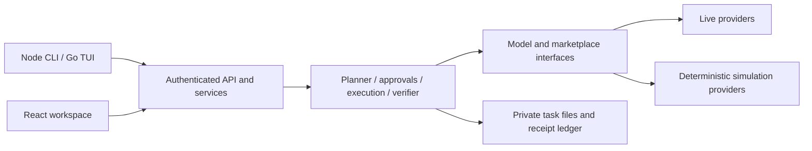

# Ash

**Plan work, hire agents within a budget, and keep verifiable evidence of every attempt.**

Ash gives one operator a terminal and browser workspace for task planning, specialist
hiring through the NEAR AI Agent Market, deliverable review, and a hash-linked receipt
ledger. The model proposes work; explicit approvals and deterministic budget checks
control what happens next.



## Try it — no configuration

Prerequisite: Node.js 22.13+ and npm. From a fresh clone:

```sh
npm install
npm run demo
```

The demo runs planning, approval, simulated delivery, verification and receipt export,
then opens the terminal workspace. Two intentional validation failures show rejected
inputs. **The frontend starts OFF** in both `npm start` and `npm run demo`:

1. Press **B** to start the frontend and display its URL (no code yet).
2. Press **B** again to display a fresh one-time access code.
3. Open `/workspace` and enter the code. The next **B** closes
   the frontend and revokes all browser sessions and unused codes.

Press Escape to dismiss the access dialog and keep using the CLI alongside the browser.
B also works directly inside that dialog. Outside it, leave text inputs before using B.
If Go is unavailable, an API-connected text shell opens automatically; use
`npm start -- --shell` or `npm run demo -- --shell` to choose it explicitly. Type `B`
and Enter in this shell. `help` lists task, approval, chat and inspection commands.

`/` is the public landing page. `/workspace` is the private operational overview;
`/workspace/controls` contains full planning, approval, execution and settings controls.
The landing page does not load private task data, even after you sign in.
[See the workspace overview](docs/screenshots/workspace-overview.png).
A short, skippable feature tour appears after the first successful sign-in; **Help** reopens it.
Sidebar sections stay in the same workspace, with browser Back/Forward support.
The menu button switches the desktop sidebar to an icon rail and opens a drawer on mobile.

**This is a simulation.** `[DEMO]` output, UI badges, and `"simulated": true` distinguish
it from live activity. Existing `.env` files, provider credentials and data paths are
ignored; each run gets a private temporary directory. No external APIs, wallets,
blockchains, database service or paid service is used. Only the local browser listener
and local filesystem are needed after dependency installation. `NODE_ENV=production`
refuses demo mode. `ASH_DEMO=1` is the explicit environment opt-in; the older
`ASH_SIMULATE` flag alone is rejected.

For CI or a terminal-only walkthrough: `npm run demo -- --headless --json` completes
the same engine flow, verifies receipts, prints results, and shuts down.

## What works

- TypeScript execution engine with dependency ordering, bounded concurrency and persisted progress.
- Per-task budgets, escrow accounting, expiring approvals and review gates.
- Existing NEAR AI Agent Market MCP buyer integration; OpenAI-compatible and Ollama model providers.
- Go/Bubble Tea workspace: chat, task creation, execution, money, evidence, settings and browser access.
- React browser workspace with automatic network globe, reduced-motion support, GPU fallback and live events.
- Single-use browser codes, local administration, cookie sessions and explicit frontend ON/OFF.
- File-backed task/approval ledgers, SHA-256 receipt chains and Markdown/JSON/HTML exports.
- Six reproducible **local simulation modules** for privacy, business, swarms, security, real-world money and social money.

The six modules do **not** prove deployed NEAR contracts, TEE attestation, live NEAR
Intents settlement or treasury integration. Live mode never substitutes their fixtures
for provider results. Marketplace funding/acceptance pages still require the human.

## Local development and live use

```sh
npm ci --ignore-scripts
npm run build
# Create .env from .env.example only if .env does not already exist; configure your providers.
npm start
```

Go 1.25+ builds the TUI; without Go, the Node CLI and browser remain available. For a
provider-free preview use the demo above. Normal planning requires a configured model
and fails with an actionable error when it is missing. Existing state can still be
inspected with read-only commands. Optional Telegram delivery requires explicit bot/chat
configuration and is disabled by demo mode.

The `.env.example` file documents every setting. The main ones are:

| Setting | Purpose |
| --- | --- |
| `ASH_MODEL_PROVIDER`, `ASH_MODEL_NAME`, `ASH_MODEL_BASE_URL` | `openai-compatible` or `ollama` model configuration |
| `ASH_MODEL_API_KEY` / `_FILE` | Model credential; keep it outside Git |
| `MARKET_API_TOKEN` / `_FILE` | NEAR AI Agent Market buyer credential |
| `ASH_DATA_DIR` | Private persistent state; default `.ash-data` |
| `ASH_SERVER_TOKEN` | Host/API bearer credential; required for public binding |
| `ASH_SERVER_UI` | Start frontend after restart; default `false` |
| `ASH_BIND_HOST`, `ASH_PUBLIC_URL` | Bind address and HTTPS proxy origin |
| `ASH_SERVER_PORT` / `PORT` | Listener port; default 5050 |
| `ASH_CODE_TTL_MINUTES` | Code lifetime, 1–10 minutes; default 5 |

Existing `ASH_SERVER_HOST` and `ASH_SERVER_PUBLIC_URL` names remain supported. Never
commit `.env`, token files, wallet keys or state. No wallet private key is required.

## CLI

Use `npm start -- <command>` or `node dist/index.js <command>`. If you install the local
package with `npm link`, the command is `ash`.

```sh
ash --help
ash frontend on
ash frontend code --json
ash frontend status --json
ash frontend off
ash doctor --json
ash status --json
ash verify --json
ash completion bash > ~/.ash-completion.bash
```

Every advertised command has `--help` and an example. `--no-color`, `--quiet`/`-q`,
`--verbose` and `--debug` control presentation. Inspection commands and all frontend
commands support `--json`; unsupported structured operations fail explicitly.
Financial approvals and cancellation retain their typed phrases; a generic `--yes`
does not bypass those gates. See [the command reference](docs/COMMANDS.md).

In the TUI, **N** creates a task, **I** focuses chat, **:** opens commands, and **?**
shows help. The B label shows the next action: **Start web → Get code → Close web**.
The explicit `ash frontend on` command still starts the frontend and issues a code in
one call; `code` rotates it without closing the frontend. Terminal and browser actions
use the same backend and persisted task state.

## Using Ash on a VPS

**SSH tunnel, default setup:** SSH into the VPS and run `ash frontend on`. It prints the
actual URL, code and tunnel command. On your computer, for port 5050:

```sh
ssh -L 5050:localhost:5050 user@vps
```

Keep that connection open, visit `http://localhost:5050/workspace`, and type the code into the
browser. To issue another code, SSH to the VPS and run `ash frontend code`. Do not put
codes in URLs or shell commands. They work once and expire after five minutes.

**Public HTTPS:** configure `ASH_PUBLIC_URL=https://ash.example.com`, keep
`ASH_BIND_HOST=127.0.0.1` behind Caddy/nginx, and use the supplied reverse proxy examples.
For container/platform binding, explicitly set `ASH_BIND_HOST=0.0.0.0` and
`ASH_SERVER_ALLOW_REMOTE=true`, and firewall the raw port. Public HTTP binding is refused
unless the deliberately unsafe `ASH_ALLOW_INSECURE_PUBLIC_HTTP=true` override is set.
Obtain codes in the trusted host/service terminal, including
`docker compose exec ash ash frontend code`; enter them at the HTTPS URL.

If a code fails, request a fresh one; another issuance invalidates the previous code.
After eight failed sign-ins, wait one minute. If a page cannot load, check
`ash frontend status`, the tunnel, the bind port, and proxy TLS configuration.
`ash frontend logout-all` revokes browser access without stopping the API.

## Architecture



| Directory | Contents |
| --- | --- |
| `src/cli`, `src/launcher.ts` | CLI commands, formatting and process lifecycle |
| `src/server`, `src/security` | API, codes/sessions, approvals and guards |
| `src/engine`, `src/ai`, `src/market` | Execution and provider implementations |
| `src/providers`, `src/demo` | Provider composition and isolated demo driver |
| `src/state`, `src/ledger`, `src/transactions` | Atomic persistence and accounting |
| `frontend`, `web`, `tui` | React interface, full browser controls, Go terminal client |
| `tests`, `scripts`, `deploy`, `docs` | Verification, build tooling, operations and docs |

There is no SQL database. Deploy one process per data directory on a persistent local
filesystem. Mode markers prevent mixing live and simulated state. See
[architecture](docs/ARCHITECTURE.md), [API](docs/API.md), [security](docs/SECURITY.md),
and [backup/recovery](docs/DEPLOYMENT.md#backup-and-recovery).

## Checks and deployment

```sh
npm run format:check
npm run lint
npm run typecheck
npm test
npm run test:tui
npm run build
npm run security
npm run validate:deploy
npm run test:production
npm run test:deployments
npm run test:web
```

Browser tests require Playwright Chromium (`npx playwright install chromium`). TLS
integration tests require nginx and OpenSSL. CI runs Node/TUI checks on Linux, macOS
and Windows, browser/TLS checks on Linux, the offline demo smoke test, and a Docker
image build. Exact locally executed results and limitations are in
[VERIFICATION.md](docs/VERIFICATION.md); the complete A–K delivery report is in
[FINAL_REPORT.md](docs/FINAL_REPORT.md).

Deployment files: [Render](render.yaml), [Railway](railway.json), [Dockerfile](Dockerfile),
[Compose](compose.yaml), [systemd](deploy/ash.service), [Caddy](deploy/Caddyfile.example)
and [nginx](deploy/nginx.conf.example). Follow [deployment instructions](docs/DEPLOYMENT.md)
for secrets, persistent storage, health checks, graceful shutdown and recovery.
Configuration is not evidence of a successful hosted deployment. Run `npm run test:deployments`
for the labeled local hosting simulation; `npm run test:container` requires a Docker
daemon and a built `ash:ci` image. See the [second review](docs/DEPLOYMENT_REVIEW.md).

## LICENSE

See [LICENSE](LICENSE)
